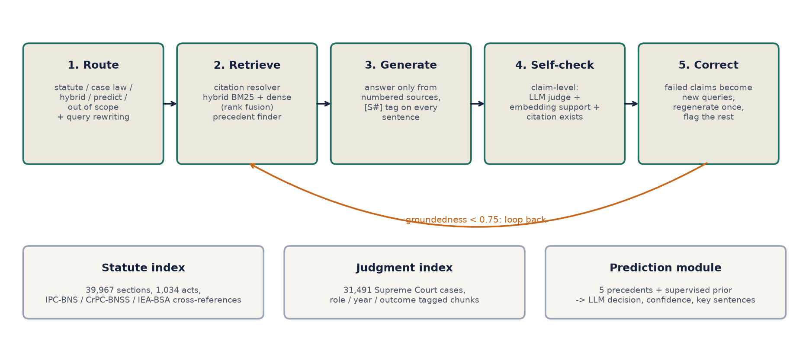
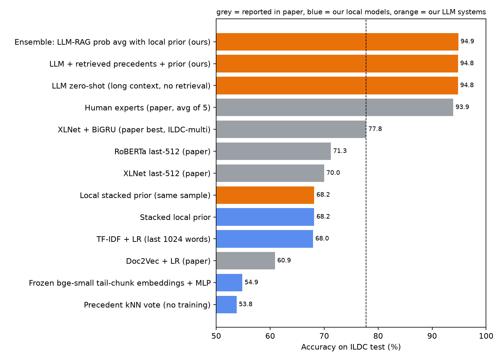
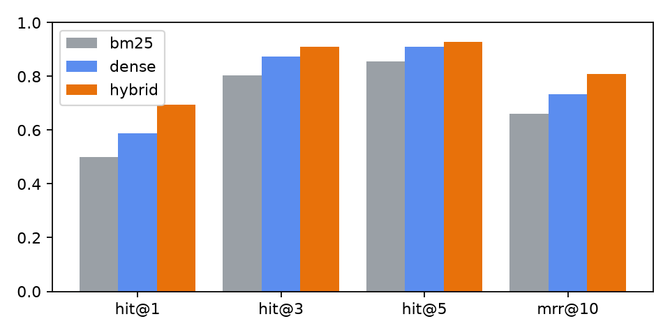

# Nyaya-RAG: An Agentic RAG System for Indian Legal Document Analysis and Research

GenAI course project report · 13 November 2026

**Code repository:** https://github.com/Sujal7508/nyaya-rag
**Live demo:** linked from the repository README
**Reference paper:** Malik et al., *ILDC for CJPE: Indian Legal Documents Corpus for Court Judgment Prediction and Explanation*, ACL 2021.

## 1. Abstract

Legal research in India means reading long Supreme Court judgments and finding the right section among thousands of statutory provisions, at a time when the criminal codes themselves have been replaced (IPC by BNS, CrPC by BNSS, Evidence Act by BSA). We built Nyaya-RAG, an agentic retrieval-augmented generation system over 31,491 Supreme Court of India judgments and 39,967 sections of 1,034 Indian bare acts. The agent routes each query, retrieves evidence with a hybrid sparse-plus-dense retriever, generates an answer in which every sentence cites its source, verifies each claim against the cited source, and corrects itself when a claim is not supported.

On the benchmark of the reference paper, our retrieval-augmented system predicts the outcome of 94.79% of the 1,517 ILDC test cases, against 77.78% for the paper's best model. Its explanations overlap more with legal experts' annotations than the paper's on four of six metrics. Hybrid retrieval places the correct statute section first for 70% of curated questions, against 50% for keyword search and 59% for dense search alone. The agentic pipeline raises answer faithfulness from 0.962 to 0.985 over plain RAG, and its self-check detects 41 of 42 deliberately injected hallucinations.

## 2. Introduction and motivation

### 2.1 The problem

Indian courts carry a very large backlog of pending cases, and a judgment of the Supreme Court is typically several thousand words long. A lawyer or student researching a point of law has to do three things: find the governing statutory provision, find how the Supreme Court has applied it, and judge how a new set of facts is likely to be decided. General-purpose chat assistants are a poor fit for this work, because they answer from memory, cannot show where a statement comes from, and are known to invent section numbers and case citations.

### 2.2 The reference paper

Malik et al. (ACL 2021) introduced the Indian Legal Documents Corpus (ILDC), about 35,000 Supreme Court of India judgments with the final order removed, and the task of Court Judgment Prediction and Explanation (CJPE): predict whether the appeal or petition was accepted or rejected, and explain the decision. Their best model, a hierarchical XLNet with a BiGRU on top, reaches 77.78% accuracy on 1,517 test cases, while human legal experts reach about 94%. Their explanations are derived from occlusion scores over 512-token chunks.

### 2.3 Limits of the paper that we address

- **Short context.** Models of that generation read 512 tokens at a time, while the median judgment in the corpus has about 2,200 words. The model never sees the facts and the reasoning together.
- **No retrieval.** Each case is classified in isolation. Courts reason from statute and precedent, and the model has access to neither.
- **Prediction only.** There is no way to ask a legal question, read an answer, and check that answer against the law.
- **No treatment of hallucination.** A generative legal assistant is only usable if unsupported statements are detected.

### 2.4 Contributions

1. An agentic RAG pipeline for Indian law with query routing, three retrieval tools, citation-grounded generation, claim-level self-evaluation and a corrective retrieval loop.
2. A hybrid retriever (BM25 plus dense embeddings with reciprocal rank fusion) that outperforms both of its components.
3. A statute corpus in which every section of the old criminal codes is linked to its counterpart in the 2023 codes, so that a question about IPC Section 302 also surfaces BNS Section 103.
4. Precedent-augmented, prior-injected judgment prediction, evaluated on the paper's own test set and expert annotations.
5. A two-signal hallucination detector, validated by injecting known errors into answers.
6. A leakage audit of the benchmark: train and test overlap is removed and accuracy is also reported on a leak-filtered subset.

## 3. Background: what retrieval is and why it matters

A large language model generates text from patterns learned during training. It has no built-in way to look anything up, so when asked for the punishment under a particular section it produces whatever is most plausible, which may be wrong or out of date. **Retrieval-augmented generation (RAG)** changes the procedure: before the model writes anything, a retriever searches a trusted document collection for passages relevant to the question, and those passages are placed in the prompt. The model is then instructed to answer only from them. This gives three benefits that matter in law: the answer is grounded in the actual text of the statute or judgment, every statement can be traced to a source, and the knowledge base can be updated without retraining the model.

The quality of a RAG system is bounded by its retriever. If the correct section is not retrieved, the generator cannot cite it. We use two complementary retrieval methods and combine them.

**Sparse retrieval (BM25).** Each document is scored by the query words it contains, weighted by how rare each word is in the collection and normalised by document length. BM25 is strong on exact legal terms such as "anticipatory bail" or "res judicata", but it fails when the question uses different words from the statute, for example "fears arrest" for "apprehending arrest".

**Dense retrieval.** A neural encoder (`BAAI/bge-small-en-v1.5`, 384 dimensions) maps the query and every passage to vectors, and passages are ranked by cosine similarity to the query. Dense retrieval matches meaning rather than words, so it handles paraphrase, but it can miss rare exact terms and treats numbers such as section numbers as nearly meaningless.

**Hybrid retrieval with reciprocal rank fusion.** We run both retrievers, take the top 40 results of each, and score every passage by the sum over the two rankings of 1 / (60 + rank). A passage ranked highly by either method, and especially by both, rises to the top. Fusion needs no training and no score calibration between the two methods.

**Agentic RAG.** In a plain RAG pipeline, retrieval happens once and the answer is returned unchecked. In an agentic pipeline, the model also decides what kind of question it is facing, which corpus and tool to use, whether its own answer is supported by the evidence, and whether to search again.

## 4. Data

| Corpus | Size | Source |
| --- | --- | --- |
| Supreme Court judgments (ILDC train, retrieval index) | 31,491 cases, 183,351 chunks | `jayadityagandham9/ILDC_35k_COMPLETE` on Hugging Face |
| ILDC test set (never indexed) | 1,517 cases | same file, last 1,517 rows |
| Expert-annotated cases | 55 cases, 5 legal experts each | `Praful932/il-tur-cjpe-noleak` |
| Bare acts | 1,034 acts, 39,967 sections | `GSMS-B/indian-legal-knowledge-base-json` and `mratanusarkar/Indian-Laws` |
| Curated evaluation queries | 74 (56 with a gold section) | written for this project |

**Split reconstruction.** The public ILDC file has no split column. Its row counts match the paper's Table 1 exactly (32,305 multi-train, 5,082 single-train, 1,517 test), so the splits were rebuilt from row order and verified against an independent copy of the test ids.

**Leakage control.** We removed duplicate judgments and every training case that shares an id or a text ending with a test case. This reduces the training pool from 37,387 to 31,491 cases. Test cases are never placed in the retrieval index.

**Statutes.** Two public collections were merged into one section-level table. The first provides complete, curated text for 102 major acts, including the Indian Penal Code, Code of Criminal Procedure, Evidence Act, Constitution of India and the 2023 codes. The second adds over 900 further central acts. Official mapping tables between the old and new criminal codes were attached to 2,318 sections as cross-reference text.

**Curated queries.** We wrote 74 evaluation queries: 56 plain-language statute questions with a known correct section (for example "How can a person who fears arrest get bail in advance?" with gold answer CrPC Section 438), 8 case-law questions, 6 questions needing both statute and case law, 2 direct citation questions and 2 out-of-scope questions. Statute questions never mention the section number. Each gold section was checked against the actual text in the index.

## 5. System design

### 5.1 Document-aware chunking and indexing

Supreme Court judgments follow a recognisable structure: facts and procedural history first, the submissions of counsel in the middle, and the Court's own reasoning and conclusion at the end. We split each judgment into 300-word windows aligned to the end of the document and keep the first two windows (facts) and the last six (reasoning). Every chunk is tagged with its role, the case id, the year and the outcome of the case. Statutes are chunked one section per chunk and are never split across sections, so a retrieved passage is always a complete provision with its act and chapter in the header.

All chunks are embedded locally with `bge-small-en-v1.5` and indexed with BM25. A case-level vector, the mean of the reasoning-chunk embeddings, supports precedent search.

### 5.2 Step 1: query router

An LLM classifies the query into one of five routes and rewrites it into one to three keyword-rich search queries with abbreviations expanded (IPC to Indian Penal Code).

| Route | Meaning | Corpus searched |
| --- | --- | --- |
| statute | What a law, section or article says | Bare acts |
| case_law | How the Supreme Court has reasoned on an issue | Judgments |
| hybrid | Needs both | Both, with both evidence types kept |
| predict | The user pasted a case and wants the likely outcome | Prediction module |
| out_of_scope | Not about Indian law | None, polite refusal |

### 5.3 Step 2: retrieval tools

- **Citation resolver.** A query such as "Section 302 IPC", "u/s 138 NI Act" or "Article 21" is resolved by pattern matching and an alias table directly to the exact section. Each section number is paired with the nearest act mentioned in the query. No embedding is used, because section numbers carry no semantic meaning.
- **Hybrid search.** BM25 plus dense search with reciprocal rank fusion, as described in Section 3. For judgments, at most two chunks per case are kept so that one long case cannot fill the context.
- **Precedent finder.** Given the text of a new case, it returns the nearest past judgments at case level with their known outcomes.

### 5.4 Step 3: citation-grounded generation

The generator receives the numbered sources and is instructed to answer only from them, to end every sentence that states law or facts with the tags of the supporting sources (for example [S2]), to quote section numbers exactly, and to say plainly when the sources do not contain the answer.

### 5.5 Step 4: self-evaluation

The answer is split into individual claims. Each claim is checked in three ways:

1. **Citation existence.** A claim that cites a source number that does not exist is marked unsupported.
2. **LLM judge.** A separate prompt asks whether the cited sources fully support the claim, with verdicts supported, partial or unsupported, and an instruction to check section numbers, punishments, dates and outcomes exactly.
3. **Embedding support.** The cosine similarity between the claim and the most similar sentence of its cited source.

Groundedness is the mean over claims of 1 for supported, 0.5 for partial and 0 otherwise.

### 5.6 Step 5: corrective loop

If groundedness is below 0.75, the unsupported claims themselves are used as new search queries, the new passages are added to the sources, and the answer is regenerated once with the list of failed claims as feedback. The better of the two drafts is kept, and any claim that still fails is shown to the user with its verdict.

### 5.7 Judgment prediction module

For a pasted case the system performs retrieval-augmented prediction:

1. The precedent finder retrieves the five most similar past cases, and the ending of each with its outcome is placed in the prompt.
2. A supervised prior is computed by a stack of three inexpensive local models trained on the 31,491 training cases: TF-IDF with logistic regression on the last 1,024 words, an MLP on the embeddings of the last six chunks, and a similarity-weighted vote of the 25 nearest precedents. The stacking weights are fitted on a held-out development set of 887 cases.
3. The LLM reads the opening 600 words and the final 3,400 words of the case together with the precedents and the prior, and returns the appellant, a short reasoning, the decision, a confidence, and up to eight sentences copied verbatim from the case that justify the decision. These sentences are the explanation.

### 5.8 Implementation

The system is written in Python. Retrieval, embeddings and the local models run on a laptop (Apple M4, 16 GB). The LLM client supports several providers behind one interface, with a disk cache, rate limiting and automatic fallback between models. Experiments used `gemini-3.5-flash-lite` and `gemini-3.1-flash-lite` with no fine-tuning. A Streamlit application exposes the agent with its trace, per-claim verdicts and sources.

## 6. Experiments and results

### 6.1 Judgment prediction on the ILDC test set

Our retrieval-augmented system reaches 94.79% accuracy on the full test set of 1,517 cases, 17 points above the best model in the paper and on par with the human experts reported there.

| System | Test cases | Accuracy % | Macro-F1 % |
| --- | --- | --- | --- |
| Doc2Vec + LR (paper) | 1,517 | 60.91 | 62.00 |
| XLNet, last 512 tokens (paper) | 1,517 | 70.01 | 71.07 |
| RoBERTa, last 512 tokens (paper) | 1,517 | 71.26 | 71.77 |
| XLNet + BiGRU (paper, best) | 1,517 | 77.78 | 77.79 |
| Human experts (paper, mean of 5) | 56 | 93.93 | |
| TF-IDF + logistic regression (ours, local) | 1,517 | 67.96 | 67.18 |
| Stacked local prior (ours, local) | 1,517 | 68.16 | 68.14 |
| **Nyaya-RAG: LLM + retrieved precedents + prior** | 1,517 | **94.79** | 94.79 |
| Nyaya-RAG, confidence averaged with local prior | 1,517 | 94.86 | 94.85 |

- The 95% confidence interval for 94.79% on 1,517 cases is 93.7 to 95.9.
- **Leakage check.** Some ILDC test documents still contain an explicit verdict phrase near the end. On the 1,364 test cases without such a phrase, accuracy is 94.72%, so the result does not depend on leaked verdicts.
- **Robustness.** With the last 150 words of each case hidden, 40 of 40 sampled cases were still predicted correctly.
- 7 of 3,034 model replies could not be parsed and are counted as wrong.

**Error analysis.** The errors we inspected were mostly cases where the outcome label is itself debatable: appeals that are formally dismissed while the Court grants directions or modifies the decree, and cases where several appeals are decided together. For example, in one test case the Court modified the High Court's decree on the distribution of a fund, which the system read as partial success for the appellant, while the gold label is rejected. The paper reports that its own expert annotators disagreed with the official label on 2 to 11% of cases for the same reason.

### 6.2 Explanation quality against legal experts

The paper evaluates explanations by their overlap with sentences highlighted by five legal experts. We use the same expert annotations. On 55 annotated cases the system selected about 11 sentences per case, and 98% of them appear verbatim in the judgment. The table gives the mean over the five experts.

| Metric | Ours | Paper (occlusion) |
| --- | --- | --- |
| ROUGE-1 | 0.457 | 0.451 |
| ROUGE-2 | 0.389 | 0.297 |
| ROUGE-L | 0.311 | 0.424 |
| Jaccard | 0.380 | 0.324 |
| Overlap-min | 0.875 | 0.719 |
| Overlap-max | 0.410 | 0.383 |

Our explanations are closer to the experts on four metrics, level on ROUGE-1 and lower on ROUGE-L. ROUGE-L rewards the longest common subsequence and therefore sentence order; the system lists sentences by importance, not in document order. Jaccard and overlap are computed on word sets here, which may differ slightly from the paper's definition.

### 6.3 Retrieval quality

This experiment isolates the retriever. For each of the 56 statute questions we check where the gold section appears in the ranked results over all 39,967 sections. No LLM is involved.

| Retriever | Hit@1 | Hit@3 | Hit@5 | MRR@10 |
| --- | --- | --- | --- | --- |
| BM25 (sparse) | 0.500 | 0.804 | 0.857 | 0.661 |
| Dense (bge-small) | 0.589 | 0.875 | 0.911 | 0.734 |
| **Hybrid (reciprocal rank fusion)** | **0.696** | **0.911** | **0.929** | **0.809** |

Hybrid retrieval improves Hit@1 by 20 points over BM25 and 11 points over dense search, and MRR by 0.15 and 0.08. The two methods fail on different questions: BM25 misses paraphrased questions, dense search misses questions that hinge on an exact legal term, and fusion recovers most of both. When the official BNS, BNSS or BSA counterpart of the gold section is also accepted, hybrid Hit@1 is 0.821; many strict misses are the system returning the new-code equivalent first.

### 6.4 End-to-end answer quality

We compare the full agentic pipeline with a plain RAG baseline (one dense retrieval, then generation) on 46 of the curated queries, using RAGAS-style metrics judged by an LLM. Faithfulness is the claim-level groundedness of the answer; gold section cited is the share of statute questions whose answer cites the correct section.

| System | Faithfulness | Citation validity | Answer relevance | Gold section cited |
| --- | --- | --- | --- | --- |
| Plain RAG (dense top-k, then generate) | 0.962 | 0.983 | 0.983 | 0.893 |
| **Agentic (ours)** | **0.985** | **0.990** | 0.977 | **0.929** |

Better retrieval translates into better answers: the agentic pipeline cites the correct section more often (0.929 against 0.893) and its answers are more faithful to their sources (0.985 against 0.962), with answer relevance essentially unchanged. The router chose an acceptable route for all 46 queries and refused both out-of-scope questions. The corrective loop fired once and raised that answer's groundedness from 0.71 to 1.0.

**Example.** For the question "What is the law on anticipatory bail and what factors has the Supreme Court said courts should consider?", the router chose the hybrid route. The answer cited Section 438 of the Code of Criminal Procedure and its successor, Section 482 of the Bharatiya Nagarik Suraksha Sanhita, for the statutory rule, and a 2015 Supreme Court judgment for the factors: the nature and gravity of the accusation, the applicant's antecedents, the possibility of fleeing from justice and the likelihood of repeating the offence. Every claim was judged supported.

### 6.5 Hallucination detection

To test whether the self-check catches errors, we took claims it had accepted as supported, corrupted one fact in each by program, and ran the check again.

| Injected error | Kind of change | Detected |
| --- | --- | --- |
| Wrong section or article number | The cited number is replaced by another number | 15 of 15 |
| Wrong duration | A term of years, months or days is replaced by another | 4 of 4 |
| Flipped polarity or outcome | A negation or an outcome word is reversed | 22 of 23 |

Overall 41 of 42 injected errors were detected (97.6%), and none of the untouched claims in the same answers was wrongly flagged. The embedding-support score fell by only 0.019 on average for the corrupted claims, which shows that similarity alone cannot detect a changed number or a negation; the LLM judge is the component that detects errors, and the embedding score serves as a check that a claim is about the same subject as its source.

## 7. Discussion

- **Reading the whole judgment with evidence is what closes the gap to human experts.** The paper's models were limited to 512-token windows. Our system reads the facts and the Court's reasoning together and reaches the accuracy the paper reports for legal experts, without any training on ILDC.
- **Retrieval quality drives answer quality.** The move from single-method to hybrid retrieval is the largest measured gain in the pipeline, and it carries through to more correct citations and more faithful answers.
- **Legal retrieval needs both exact and semantic matching.** Statutory language is formulaic, so keyword search is strong, but users ask in everyday words. Neither method alone is sufficient.
- **Section numbers need symbolic handling.** A dedicated resolver for explicit citations is cheap and removes a class of errors that embedding search cannot fix.
- **Cross-references make the system usable after 2024.** Because each old-code section carries its new-code counterpart, the system answers questions phrased in either code.
- **Verification must be done by a model that reads, not by similarity.** The injection experiment shows that the claim-level LLM judge is effective and that embedding similarity is not a substitute.

## 8. Limitations and future work

- **Partial runs.** Prediction covers the full test set, but end-to-end answer quality was run on 46 of the 74 curated queries and the hidden-ending test on 40 cases.
- **Possible memorisation.** Supreme Court judgments are public, so the LLM may have seen some test cases during training. A test on judgments published after the model's training cut-off would settle this.
- **Same-family judge.** Faithfulness and relevance are judged by the same model family that generated the answers. A human-rated subset would be stronger.
- **Two models.** Prediction and explanation used `gemini-3.5-flash-lite`; answer quality, the hallucination test and the hidden-ending test used `gemini-3.1-flash-lite`.
- **Corpus coverage.** Judgments stop at 2020 and carry ILDC ids, not case names. The text has transcription artifacts such as "companyrt" for "court".
- **Not legal advice.** The system is a research aid.

Future work: add High Court judgments and case names, retrieve precedents by legal issue and by the appellant's position rather than by topic alone, add a cross-encoder reranker, and evaluate with practising lawyers.

## 9. Repository, demo and reproduction

- **Code:** https://github.com/Sujal7508/nyaya-rag
- **Live demo:** the link is in the repository README. The hosted demo uses a reduced judgment index (5,000 recent cases) and the full statute index.
- **Data sources:** the four public Hugging Face datasets listed in Section 4.

To reproduce:

1. `python3 -m venv .venv && .venv/bin/pip install -r requirements.txt`
2. Provide an LLM key in `llm_key.txt` (first line the provider, second line the key) or a Google Cloud service-account file for Vertex AI.
3. Build data and indexes: `src/prepare_data.py`, `src/prepare_acts.py`, `src/build_index.py` (about one hour on a laptop).
4. Run the evaluations in `src/`: `predict.py`, `eval_retrieval.py`, `eval_rag.py`, `eval_hallucination.py`, `eval_cjpe.py predict 1517 32`, `eval_cjpe.py explain`, then `make_results.py`.
5. Start the demo: `.venv/bin/streamlit run app.py`

Every number in this report is stored as JSON in the `results/` folder of the repository and collected in `results/RESULTS.md`.

| File | Purpose |
| --- | --- |
| `app.py` | Streamlit demo |
| `src/prepare_data.py`, `src/prepare_acts.py` | Rebuild ILDC splits, merge statutes and cross-references |
| `src/build_index.py` | Chunking, embeddings, BM25 |
| `src/retriever.py` | Hybrid retrieval, citation resolver, precedent finder |
| `src/agent.py` | Router, generation, self-check, corrective loop |
| `src/predict.py` | Local prior models and the prediction prompt |
| `src/eval_*.py` | The five evaluations in Section 6 |
| `data/eval/legal_queries.json` | The curated query set |

## 10. References

1. V. Malik, R. Sanjay, S. K. Nigam, K. Ghosh, S. K. Guha, A. Bhattacharya, A. Modi. ILDC for CJPE: Indian Legal Documents Corpus for Court Judgment Prediction and Explanation. ACL-IJCNLP 2021.
2. P. Lewis et al. Retrieval-Augmented Generation for Knowledge-Intensive NLP Tasks. NeurIPS 2020.
3. S. Robertson, H. Zaragoza. The Probabilistic Relevance Framework: BM25 and Beyond. Foundations and Trends in Information Retrieval, 2009.
4. G. V. Cormack, C. L. A. Clarke, S. Büttcher. Reciprocal Rank Fusion Outperforms Condorcet and Individual Rank Learning Methods. SIGIR 2009.
5. S. Xiao, Z. Liu, P. Zhang, N. Muennighoff. C-Pack: Packaged Resources to Advance General Chinese Embedding (BGE embeddings). 2023.
6. S. Es, J. James, L. Espinosa-Anke, S. Schockaert. RAGAS: Automated Evaluation of Retrieval Augmented Generation. 2023.
7. S.-Q. Yan, J.-C. Gu, Y. Zhu, Z.-H. Ling. Corrective Retrieval Augmented Generation. 2024.
