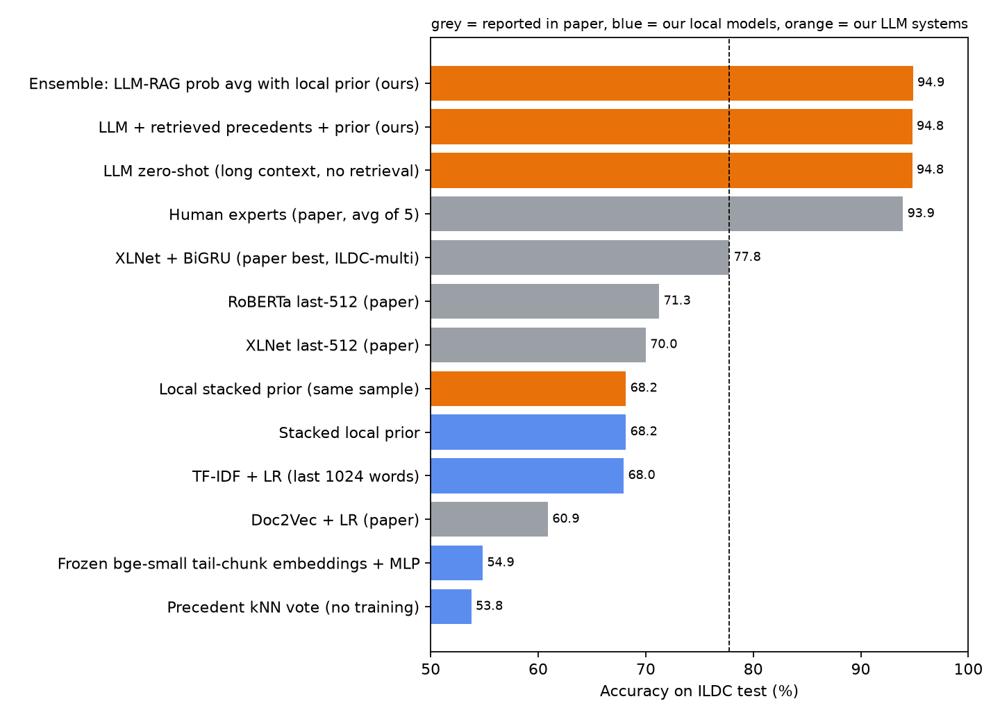
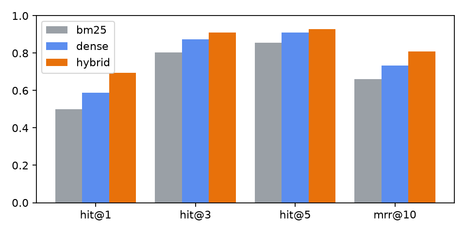

# Results

All numbers below are produced by the scripts in `src/` and stored as JSON in this folder.

## 1. Judgment prediction on the ILDC test set (paper: Malik et al., ACL 2021)

| System | Test cases | Accuracy % | Macro-F1 % | 95% CI (acc) | Acc. on leak-filtered subset % |
|---|---|---|---|---|---|
| XLNet + BiGRU (paper best, ILDC-multi) | 1517 | 77.78 | 77.79 | - | - |
| XLNet last-512 (paper) | 1517 | 70.01 | 71.07 | - | - |
| RoBERTa last-512 (paper) | 1517 | 71.26 | 71.77 | - | - |
| Doc2Vec + LR (paper) | 1517 | 60.91 | 62.0 | - | - |
| Human experts (paper, avg of 5) | 1517 | 93.93 | - | - | - |
| TF-IDF + LR (last 1024 words) | 1517 | 67.96 | 67.18 | 65.6-70.3 | 67.45 |
| Frozen bge-small tail-chunk embeddings + MLP | 1517 | 54.85 | 51.89 | 52.3-57.3 | 55.65 |
| Precedent kNN vote (no training) | 1517 | 53.79 | 50.07 | 51.3-56.3 | 55.72 |
| Stacked local prior | 1517 | 68.16 | 68.14 | 65.8-70.5 | 66.94 |
| **LLM zero-shot (long context, no retrieval)** | 1517 | **94.79** | 94.78 | 93.7-95.9 | 94.79 (n=1364) |
| **LLM + retrieved precedents + prior (ours)** | 1517 | **94.79** | 94.79 | 93.7-95.9 | 94.72 (n=1364) |
| **Ensemble: LLM-RAG prob avg with local prior (ours)** | 1517 | **94.86** | 94.85 | 93.7-96.0 | 94.79 (n=1364) |
| **Local stacked prior (same sample)** | 1517 | **68.16** | 68.14 | 65.8-70.5 | 66.94 (n=1364) |

JSON parse failures (counted as wrong/0.5): {'zero': 5, 'rag': 2}

Robustness (40 of the sampled cases, zero-shot; hidden-ending run on gemini-3.1-flash-lite, full-text run on gemini-3.5-flash-lite): with the last 150 words of each case hidden, accuracy goes from 97.5% to 100.0%.

## 2. Explanation quality vs. legal experts (expert-annotated ILDC cases)

55 cases; our explanations = sentences the LLM copies from the judgment (avg 10.7 sentences, 98% found verbatim in the source). Prediction accuracy on these cases: 94.55%.

| Metric | E1 ours / paper | E2 ours / paper | E3 ours / paper | E4 ours / paper | E5 ours / paper | mean ours / paper |
|---|---|---|---|---|---|---|
| rouge1 | 0.442 / 0.444 | 0.560 / 0.517 | 0.363 / 0.401 | 0.344 / 0.391 | 0.577 / 0.501 | **0.457** / 0.451 |
| rouge2 | 0.403 / 0.303 | 0.422 / 0.295 | 0.324 / 0.296 | 0.327 / 0.297 | 0.471 / 0.294 | **0.389** / 0.297 |
| rougeL | 0.316 / 0.439 | 0.339 / 0.407 | 0.297 / 0.423 | 0.257 / 0.444 | 0.345 / 0.407 | **0.311** / 0.424 |
| jaccard | 0.393 / 0.333 | 0.406 / 0.317 | 0.325 / 0.328 | 0.328 / 0.324 | 0.448 / 0.318 | **0.380** / 0.324 |
| overlap_min | 0.927 / 0.744 | 0.748 / 0.589 | 0.919 / 0.810 | 0.968 / 0.834 | 0.811 / 0.617 | **0.875** / 0.719 |
| overlap_max | 0.409 / 0.390 | 0.473 / 0.414 | 0.337 / 0.360 | 0.332 / 0.350 | 0.501 / 0.401 | **0.410** / 0.383 |

## 3. Statute retrieval (curated queries with gold sections, no LLM)

56 plain-language questions over 39967 sections. Lenient = the official BNS/BNSS/BSA counterpart of the gold section also counts.

| Retriever | Hit@1 | Hit@3 | Hit@5 | MRR@10 | Hit@1 (lenient) | Hit@5 (lenient) | MRR@10 (lenient) |
|---|---|---|---|---|---|---|---|
| bm25 | 0.5 | 0.804 | 0.857 | 0.661 | 0.643 | 0.893 | 0.758 |
| dense | 0.589 | 0.875 | 0.911 | 0.734 | 0.732 | 0.929 | 0.821 |
| hybrid | 0.696 | 0.911 | 0.929 | 0.809 | 0.821 | 0.946 | 0.88 |

## 4. End-to-end answer quality (RAGAS-style, LLM-judged)

46 curated queries; judge and generator: `gemini-3.1-flash-lite`.

| System | Faithfulness | Citation validity | Answer relevance | Gold section cited |
|---|---|---|---|---|
| Vanilla RAG (dense top-k -> generate) | 0.962 | 0.983 | 0.983 | 0.893 |
| Agentic (ours) | 0.985 | 0.99 | 0.977 | 0.929 |

Router accuracy 1.0; out-of-scope refused 2/2; corrective loop fired on 1 queries.

## 5. Hallucination detection (self-evaluation module)

42 supported claims were corrupted programmatically (wrong section number, wrong duration/quantity, flipped polarity). Detection rate **98%**, false-alarm rate on untouched claims 0%. By kind: {'duration': '4/4', 'polarity': '22/23', 'section_number': '15/15'}. Mean drop in embedding-support score: 0.0188.
